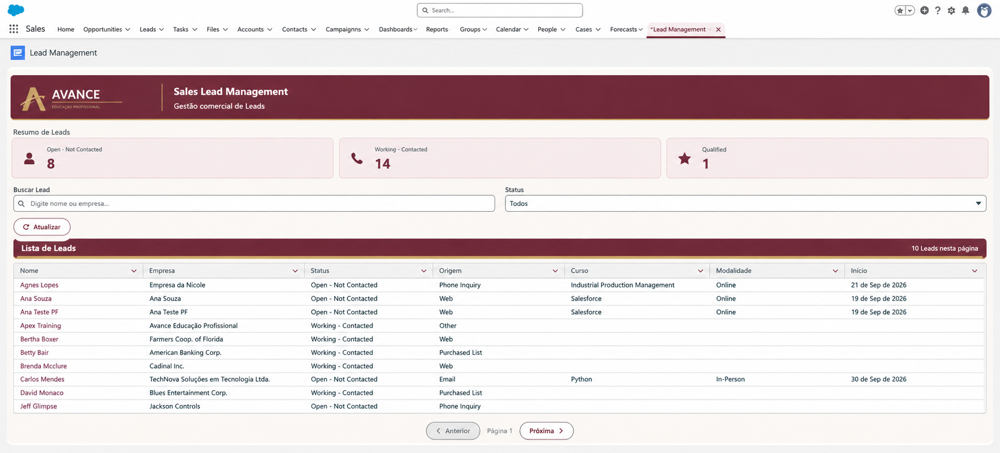

# Sales Lead Management — Avance Educação Profissional

Projeto de portfólio desenvolvido em Salesforce para gerenciamento do processo comercial da **Avance Educação Profissional**, desde a entrada e qualificação de Leads até a conversão e o acompanhamento do pipeline comercial.

A solução demonstra conhecimentos práticos em **Salesforce Development, configuração declarativa, automação de processos, integração com API externa, Apex, Lightning Web Components, testes automatizados, segurança e versionamento com Git/GitHub**.

---

## 📸 Demonstração da interface



A interface utiliza identidade visual personalizada com a paleta marsala da Avance, indicadores de acompanhamento, filtros, pesquisa e uma tabela interativa de Leads.

Os registros utilizados nas capturas de tela são fictícios, destinados à demonstração do projeto.

---

## 📌 Visão geral

A solução representa um processo comercial para captação e acompanhamento de potenciais alunos:

**Lead → Qualificação → Conversão → Account + Contact + Opportunity → Pipeline → Closed Won / Closed Lost**

A implementação segue uma abordagem **native-first**, priorizando recursos nativos e declarativos do Salesforce antes de utilizar desenvolvimento customizado.

O projeto combina Sales Cloud, Salesforce Flow, Apex, Lightning Web Components e integração externa para demonstrar um fluxo comercial próximo de um cenário empresarial.

### Objetivos

- Modelar um processo comercial no Salesforce.
- Gerenciar o ciclo de vida dos Leads.
- Validar CPF e CNPJ antes da criação do Lead.
- Integrar o Salesforce com uma API externa de validação cadastral.
- Automatizar tarefas de acompanhamento comercial.
- Demonstrar o processo nativo de conversão de Leads.
- Acompanhar o pipeline de Opportunities.
- Desenvolver uma interface personalizada com Lightning Web Components.
- Implementar Apex com tratamento de exceções e testes automatizados.
- Aplicar boas práticas de segurança e controle de acesso aos dados.
- Externalizar configurações de automação utilizando Custom Metadata Types.
- Utilizar Salesforce CLI, Salesforce DX, Git e GitHub para desenvolvimento e versionamento.

---

## 🏗️ Arquitetura da solução

A arquitetura segue a seguinte prioridade:

**Salesforce Native → Configuração Declarativa → Flow → LWC/Aura → Apex quando necessário**

```text
                         Salesforce
                             |
                         Sales Cloud
                             |
                +------------+------------+
                |                         |
              Leads                 Opportunities
                |                         |
        Cadastro Inteligente         Sales Pipeline
                |                         |
           Screen Flow              Closed Won / Lost
                |
         Pessoa Física / Jurídica
                |
            CPF / CNPJ
                |
       Integração com API externa
                |
       Validação dos dados cadastrais
                |
          Criação do Lead
                |
         Qualificação comercial
                |
       Follow-up automatizado
                |
       Conversão nativa Salesforce
                |
     Account + Contact + Opportunity
```

### Princípios técnicos

- Priorizar funcionalidades nativas do Salesforce.
- Utilizar configuração declarativa sempre que apropriado.
- Usar Flow para automações de negócio.
- Utilizar LWC quando for necessária uma experiência de interface personalizada.
- Utilizar Apex para lógica de negócio que exija processamento customizado.
- Separar Trigger e Handler.
- Externalizar configurações de automação por meio de Custom Metadata Types.
- Validar cenários positivos, negativos e de borda.
- Considerar compartilhamento, CRUD e Field-Level Security (FLS) nas operações de dados.

---

## 🔄 Processo comercial

O projeto utiliza os seguintes status de Lead no processo de qualificação:

| Status | Significado |
|---|---|
| Open - Not Contacted | Lead recebido, ainda sem contato realizado. |
| Working - Contacted | O vendedor realizou contato e está trabalhando o Lead. |
| Qualified | Interesse e perfil confirmados para avançar no processo comercial. |
| Unqualified | Lead que não atende aos critérios de qualificação. |

A conversão de um Lead qualificado utiliza o processo nativo do Salesforce, permitindo a criação ou associação de Account e Contact, além da criação de Opportunity quando aplicável.

Os valores efetivamente disponíveis na organização dependem da configuração dos campos de status e das regras de negócio.

---

## ⚙️ Cadastro Inteligente de Lead

O projeto possui uma experiência de cadastro personalizada para pessoas físicas e jurídicas.

### Funcionalidades

- Screen Flow para conduzir o processo de cadastro.
- Tratamento de CPF e CNPJ.
- Integração com serviço externo para validação cadastral.
- Validação das informações antes da continuidade do processo.
- Criação do registro de Lead no Salesforce.
- Abertura do fluxo por meio de uma ação personalizada.
- Componentes Aura e Lightning Web Components utilizados na experiência de cadastro.

A estrutura foi desenvolvida para organizar o processo de entrada de Leads e reduzir inconsistências cadastrais.

A disponibilidade do serviço externo depende da configuração da Named Credential e das permissões correspondentes na organização Salesforce.

---

## 💻 Lightning Web Components

### Lead Management

O componente `leadManagement` oferece uma interface personalizada para acompanhamento dos Leads.

#### Funcionalidades implementadas

- Indicadores de acompanhamento por status.
- Listagem de Leads utilizando `lightning/uiListsApi`.
- Pesquisa de registros.
- Filtro por status.
- Paginação.
- Atualização dos dados após operações.
- Indicador visual de carregamento.
- Tratamento de erros.
- Integração com Apex para obter os indicadores.
- Identidade visual personalizada da Avance.

#### Tecnologias utilizadas

- Lightning Web Components (LWC).
- JavaScript.
- HTML.
- CSS.
- Lightning Data Service e UI API.
- Apex.
- `refreshApex`.
- `getListRecordsByName`.
- Static Resources.

### Identidade visual

A interface utiliza uma paleta personalizada inspirada na identidade visual da Avance Educação Profissional.

| Elemento | Cor |
|---|---|
| Marsala principal | `#702D3A` |
| Fundo do painel | `#FBF8F5` |
| Fundo dos indicadores | `#F7ECEE` |
| Detalhes dourados | `#C5A46D` |

O logotipo é disponibilizado como Static Resource, com o nome `avanceLogo`.

---

## ☁️ Apex e lógica de negócio

### LeadApexService

Classe de serviço responsável por operações relacionadas aos Leads, incluindo:

- `buscarLeadsNaoConvertidos()`
- `criarLeadDeTeste()`
- `atualizarStatusLead(Id, String)`

Os métodos contemplam operações de consulta, criação e atualização de registros, com validações de negócio e tratamento de exceções conforme a implementação.

### LeadManagementController

Classe Apex utilizada pela interface de gerenciamento.

Responsabilidades:

- Obter a quantidade de Leads por status.
- Centralizar a consulta utilizada pelos indicadores da interface.
- Aplicar verificações de acesso aos dados.
- Fornecer informações ao componente `leadManagement`.

A consulta agregada utilizada para os indicadores evita concentrar o cálculo dos totais no JavaScript da interface.

### LeadBusinessTrigger e LeadBusinessHandler

A implementação separa o ponto de entrada do Trigger da lógica de processamento.

Essa separação facilita a manutenção, a organização das regras de negócio e a criação de testes automatizados.

### LeadFollowUpBatch

Classe Batch Apex destinada ao processamento assíncrono de Leads para acompanhamento comercial.

O processamento em lotes permite tratar conjuntos de registros de forma escalável dentro dos limites da plataforma.

### LeadFollowUpQueueable

Classe Queueable Apex utilizada para executar o processamento assíncrono de acompanhamento.

A utilização de Queueable Apex demonstra uma alternativa de execução assíncrona para operações que não precisam ser processadas em um único fluxo síncrono.

### LeadValidationService e LeadValidationException

A camada de validação concentra regras específicas de validação de Leads.

A exceção personalizada `LeadValidationException` permite representar falhas de validação de negócio de maneira explícita.

---

## 🧩 Custom Metadata Types

O projeto utiliza o Custom Metadata Type:

`Lead_Automation_Configuration__mdt`

Esse recurso permite externalizar parâmetros de automação da implementação Apex.

### Campos utilizados

| Campo | Finalidade |
|---|---|
| `Active__c` | Controla a ativação da configuração. |
| `Trigger_Status__c` | Define o status relacionado à configuração. |
| `Description_Message__c` | Armazena a mensagem ou descrição associada à configuração. |

### Registros de configuração

| Registro | Finalidade |
|---|---|
| `Qualified_Lead` | Configuração relacionada a Leads qualificados. |
| `Batch_Follow_Up` | Configuração relacionada ao acompanhamento em lote. |
| `Queueable_Follow_Up` | Configuração relacionada ao acompanhamento assíncrono. |

O uso de Custom Metadata Types reduz a necessidade de manter parâmetros de negócio fixos diretamente no código e facilita ajustes de configuração.

---

## 🔁 Salesforce Flows

O projeto contempla automações declarativas para apoiar o processo comercial.

### Cadastro Inteligente de Lead

Screen Flow responsável por conduzir a experiência de cadastro, incluindo a validação dos dados cadastrais.

### Lead Qualified Follow-up Task

Flow responsável pela criação de tarefas de acompanhamento quando um Lead atende à condição de qualificação definida.

### Opportunity Closed Won Enrollment Task

Flow associado ao processo de Opportunity com status Closed Won, para automatizar a criação de tarefa relacionada ao acompanhamento da conversão comercial.

Essas automações demonstram o uso de Salesforce Flow para reduzir atividades manuais e padronizar o processo de negócio.

---

## 🔐 Segurança e qualidade de código

O projeto incorpora verificações de segurança e práticas recomendadas para desenvolvimento Salesforce.

### Controle de acesso

- Uso de `with sharing` nas classes correspondentes.
- Verificações de acesso ao objeto por meio de CRUD.
- Verificações de Field-Level Security (FLS).
- Verificações dos campos utilizados nas operações de consulta e processamento.
- Consideração das permissões do usuário nas operações relacionadas aos Leads.

A aplicação dessas verificações busca evitar que a lógica Apex exponha ou modifique dados além dos acessos permitidos ao contexto de execução.

### Tratamento de exceções

O projeto utiliza tratamento de exceções para tornar as falhas mais previsíveis e facilitar o diagnóstico de erros nas operações de negócio.

### Logging

As implementações assíncronas utilizam registros de log para apoiar o acompanhamento da execução.

O nível de logging é utilizado para diferenciar informações operacionais de situações que exigem atenção.

---

## 🧪 Testes automatizados

O projeto inclui classes de teste Apex e testes Jest para o componente Lightning Web Components.

### Classes Apex

| Classe de teste | Escopo |
|---|---|
| `LeadApexServiceTest` | Testes das operações de serviço relacionadas a Leads. |
| `LeadManagementControllerTest` | Testes do controlador utilizado pela interface. |
| `LeadBusinessHandlerTest` | Testes da lógica de processamento do Handler. |
| `LeadFollowUpBatchTest` | Testes do processamento Batch Apex. |
| `LeadFollowUpQueueableTest` | Testes do processamento Queueable Apex. |
| `LeadValidationServiceTest` | Testes das regras de validação. |

As classes foram executadas durante o desenvolvimento, incluindo validações individuais após mudanças na segurança dos serviços e do controlador.

### Lightning Web Components

O componente `leadManagement` possui testes Jest voltados à validação do comportamento da interface.

Durante o desenvolvimento, foi registrada uma execução com **1 suíte e 9 testes Jest aprovados**, antes das alterações visuais mais recentes.

Os resultados de testes devem ser revalidados após futuras modificações no código.

### Executar testes Apex

Com o Salesforce CLI instalado e uma organização autorizada:

```powershell
sf apex run test `
  --target-org AvanceEducacao `
  --tests LeadApexServiceTest `
  --result-format human `
  --wait 30
```

Para executar todas as classes Apex de teste disponíveis na organização:

```powershell
sf apex run test `
  --target-org AvanceEducacao `
  --result-format human `
  --wait 30
```

A execução depende de a organização estar autorizada e de as classes estarem disponíveis nela.

---

## 🛠️ Tecnologias e ferramentas

| Tecnologia | Utilização |
|---|---|
| Salesforce Sales Cloud | Gestão de Leads, Accounts, Contacts e Opportunities. |
| Apex | Lógica de negócio e processamento de dados. |
| Salesforce Flow | Automação declarativa de processos. |
| Lightning Web Components | Interface personalizada. |
| Aura Components | Integração com a experiência personalizada de cadastro. |
| Batch Apex | Processamento assíncrono em lotes. |
| Queueable Apex | Execução assíncrona de operações. |
| Custom Metadata Types | Configuração de comportamento da automação. |
| Named Credentials | Configuração da conexão com serviço externo. |
| Salesforce CLI | Implantação, recuperação de metadados e execução de testes. |
| Salesforce DX | Organização do projeto e metadados. |
| Jest | Testes do Lightning Web Components. |
| Git e GitHub | Versionamento e publicação do código-fonte. |
| PowerShell | Execução de comandos de desenvolvimento no Windows. |

---

## 📁 Estrutura do projeto

A estrutura utiliza o formato Salesforce DX.

```text
sales-lead-management-avance/
│
├── force-app/
│   └── main/
│       └── default/
│           ├── aura/
│           │   └── LeadNewOverride/
│           │
│           ├── classes/
│           │   ├── CpfCnpjValidator.cls
│           │   ├── LeadApexService.cls
│           │   ├── LeadManagementController.cls
│           │   ├── LeadBusinessTrigger.trigger
│           │   ├── LeadBusinessHandler.cls
│           │   ├── LeadFollowUpBatch.cls
│           │   ├── LeadFollowUpQueueable.cls
│           │   ├── LeadValidationService.cls
│           │   └── LeadValidationException.cls
│           │
│           ├── flows/
│           │
│           ├── lwc/
│           │   ├── leadFlowLauncher/
│           │   ├── leadFlowModal/
│           │   └── leadManagement/
│           │
│           ├── objects/
│           │
│           └── staticresources/
│               └── avanceLogo.png
│
├── docs/
│   └── images/
│       └── lead-management-dashboard.png
│
├── README.md
├── sfdx-project.json
└── package.json
```

A árvore acima destaca os principais diretórios e componentes. Os metadados complementares, arquivos de teste e demais recursos permanecem nos respectivos diretórios do projeto.

---

## 🚀 Configuração e execução

### Pré-requisitos

- Salesforce CLI.
- Git.
- Node.js e npm para executar os testes Jest configurados.
- Uma organização Salesforce com permissões de desenvolvimento.
- Configuração necessária para a integração externa, incluindo Named Credential e permissões de acesso.

### 1. Clonar o repositório

```powershell
git clone https://github.com/nicolemartinsmaahs-cpu/sales-lead-management-avance.git
```

### 2. Acessar o projeto

```powershell
cd sales-lead-management-avance
```

### 3. Autorizar uma organização Salesforce

```powershell
sf org login web --alias AvanceEducacao
```

O comando abrirá o navegador para autenticação. Utilize uma organização Salesforce apropriada para desenvolvimento e testes.

### 4. Verificar a organização autenticada

```powershell
sf org display --target-org AvanceEducacao
```

### 5. Implantar os metadados

Após confirmar que o projeto está configurado e que a organização de destino possui os pré-requisitos necessários:

```powershell
sf project deploy start `
  --source-dir force-app/main/default `
  --target-org AvanceEducacao
```

A implantação pode exigir configurações adicionais específicas da organização, como permissões, Named Credentials, valores de configuração, dependências e ativação de Flows.

**Atenção:** não execute uma implantação em uma organização de produção sem revisar previamente os metadados e o impacto da implantação.

---

## 🔧 Desenvolvimento e versionamento

O projeto utiliza Git para manter o histórico de alterações e GitHub para disponibilizar o código-fonte.

### Verificar alterações

```powershell
git status
git diff
```

### Preparar e registrar alterações

```powershell
git add .
git commit -m "feat: describe the change"
```

### Publicar alterações

```powershell
git push origin main
```

O histórico do repositório registra implementações de automação, melhorias de segurança, identidade visual e atualizações da documentação.

---

## 📈 Competências demonstradas

Este projeto demonstra conhecimentos aplicados em:

- Desenvolvimento Salesforce com Apex.
- Lightning Web Components.
- Integrações externas.
- Salesforce Flow e automação declarativa.
- Modelagem e gerenciamento do ciclo de vida de Leads.
- Batch Apex e Queueable Apex.
- Custom Metadata Types.
- Segurança de dados, CRUD e FLS.
- Testes unitários Apex e Jest.
- Tratamento de exceções e logging.
- Desenvolvimento com Salesforce DX e Salesforce CLI.
- Versionamento com Git e GitHub.
- Organização de código e separação de responsabilidades.
- Construção de interfaces personalizadas com identidade visual.

---

## 🔮 Possíveis evoluções

O projeto pode evoluir com novas funcionalidades, como:

- Painéis analíticos de conversão e desempenho comercial.
- Métricas de tempo de atendimento e follow-up.
- Ampliação dos cenários de testes automatizados.
- Aprimoramento da experiência responsiva em dispositivos móveis.
- Pipeline de integração contínua para validação de metadados e execução de testes.
- Monitoramento estruturado de falhas de integração.
- Documentação visual de arquitetura e fluxos de automação.

---

## 👩‍💻 Autoria

Projeto de portfólio desenvolvido por **Nicole Martins**, com foco em desenvolvimento Salesforce e automação de processos comerciais.

**Repositório:**
https://github.com/nicolemartinsmaahs-cpu/sales-lead-management-avance

**Tecnologias principais:** Salesforce, Apex, Lightning Web Components, Salesforce Flow, Batch Apex, Queueable Apex, Custom Metadata Types, Jest, Salesforce CLI e Git.

---

*Este é um projeto de portfólio para fins de demonstração técnica. Os dados exibidos nas capturas de tela são fictícios. A execução completa em outra organização depende da configuração dos metadados, permissões e integrações necessárias.*
